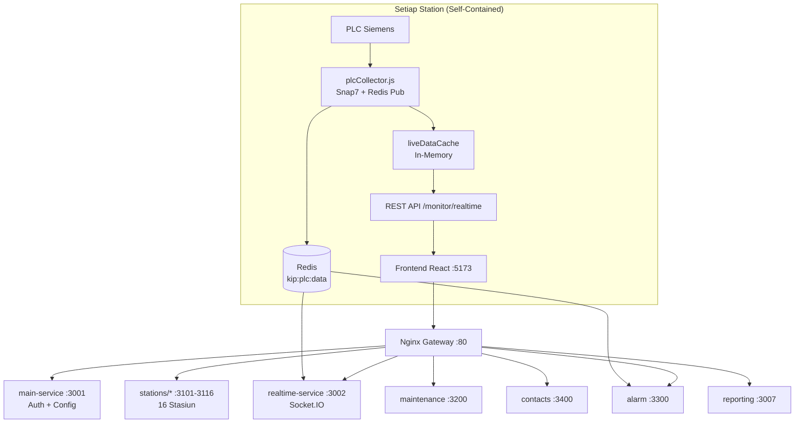

# MEWAH-KIP — SCADA CPO Mill

**Mill:** KIP (Kebun Inti Pabrik) | **Version:** 2.0.0 | **Platform:** Node.js + MySQL + Redis

> Sistem monitoring CPO Mill dengan 26 microservices. Setiap stasiun bersifat **self-contained**: punya database, backend, frontend, dan PLC Collector sendiri.

---

## DAFTAR ISI

1. [Arsitektur](#1-arsitektur)
2. [Struktur Folder](#2-struktur-folder)
3. [Port Allocation](#3-port-allocation)
4. [Instalasi](#4-instalasi)
5. [Menjalankan Proyek](#5-menjalankan-proyek)
6. [Database](#6-database)
7. [PLC Integration](#7-plc-integration)
8. [Tambah Stasiun Baru](#8-tambah-stasiun-baru)
9. [Stasiun Management](#9-stasiun-management)
10. [Lock / Unlock Stasiun](#10-lock--unlock-stasiun)
11. [Threshold & Alarm](#11-threshold--alarm)
12. [Troubleshooting](#12-troubleshooting)

---

## 1. ARSITEKTUR

### Diagram Arsitektur (Self-Contained per Station)



### Alur Data

```
PLC → plcCollector (dalam station backend) → liveDataCache → MonitorView
                                          → Redis → realtime-service (Socket.IO)
                                          → Redis → alarm-service (Telegram)
                                          → DB sendiri (plc_tag_latest + plc_tag_values)
```

**Tidak ada central collector.** Setiap station punya collector sendiri yang:
1. Membaca `plc_devices` dan `plc_tags` dari database sendiri
2. Konek ke PLC via Snap7
3. Polling setiap 200ms
4. Update `liveDataCache` langsung (tanpa Redis)
5. Publish ke Redis untuk service lain
6. Simpan ke database sendiri

### 26 Services

| Layer | Services |
|---|---|
| **Infrastructure** | MySQL, Redis |
| **Gateway** | Nginx |
| **Horizontal** | main-service, realtime-service, logsheet-service, grading-service, reporting-service |
| **Domain** | alarm, contacts, maintenance |
| **Stations (16)** | security, weighbridge, grading-ramp, loading-ramp, sterilizer, threshing, efb-plant, press, kernel-plant, oil-clarification, boiler-house, engine-room, raw-water-treatment, daf-osr, cmrs, effluent-treatment |
| **Frontend** | React Vite |

---

## 2. STRUKTUR FOLDER

```
MEWAH-KIP/
│
├── main-service/              # Auth, Config, Frontend Shell
│   ├── backend/               # Express API (:3001)
│   ├── frontend/              # React Vite (:5173)
│   └── database/schema.sql
│
├── services/                  # Layanan Horizontal
│   ├── realtime-service/      # Socket.IO broadcast (:3002)
│   ├── logsheet-service/      # Form logsheet (:3005)
│   ├── grading-service/       # AI grading (:3006)
│   └── reporting-service/     # Report aggregasi (:3007)
│
├── alarm/                     # Alarm + Telegram (:3300)
├── contacts/                  # Personalia (:3400)
├── maintenance/               # Preventive + Sparepart (:3200)
│
├── stations/                  # 16 Stasiun Mill (Self-Contained)
│   ├── _template/             # Template untuk clone stasiun baru
│   ├── sterilizer/            # (:3105)
│   │   ├── backend/
│   │   │   └── src/
│   │   │       ├── server.js          # Entry point
│   │   │       ├── plcCollector.js    # PLC Collector mandiri
│   │   │       ├── snap7Client.js     # Snap7 wrapper
│   │   │       ├── config/db.js
│   │   │       ├── routes/
│   │   │       │   ├── plcConfigRoutes.js
│   │   │       │   ├── monitorRoutes.js
│   │   │       │   ├── logsheetRoutes.js
│   │   │       │   └── settingsRoutes.js
│   │   │       └── middleware/
│   │   ├── frontend/src/
│   │   │   ├── PlcConfigView.jsx
│   │   │   ├── MonitorView.jsx
│   │   │   └── SterilizerStationPage.jsx
│   │   └── database/
│   │       └── schema.sql         # Termasuk 6 tabel PLC
│   ├── threshing/              # (:3106)
│   ├── press/                  # (:3108)
│   └── ... (16 total)
│
├── gateway/
│   └── nginx.conf
│
├── ecosystem.config.cjs        # PM2 config
├── docker-compose.yml          # MySQL + Redis
├── start.ps1                   # One-click start
├── import-all.ps1              # Import semua database
└── README.md                   # ← Dokumen ini
```

### Dalam Setiap Station (`stations/*/backend/src/`)

| File | Fungsi |
|------|--------|
| `server.js` | Entry point Express + start `plcCollector` |
| `plcCollector.js` | **PLC Collector mandiri:** baca config dari DB sendiri → konek Snap7 → polling → update liveDataCache → publish Redis → simpan DB |
| `snap7Client.js` | Snap7 wrapper + simulator (jika `node-snap7` tidak terinstall) |
| `config/db.js` | Koneksi ke database station sendiri |
| `routes/plcConfigRoutes.js` | CRUD devices & tags + endpoint `tags-live` |
| `routes/monitorRoutes.js` | `GET /monitor/realtime` → `liveDataCache` |

---

## 3. PORT ALLOCATION

| Port | Service | Fungsi |
|------|---------|--------|
| 3001 | main-service | Auth, Config, Admin |
| 3002 | realtime-service | Socket.IO broadcast |
| 3005 | logsheet-service | Manual logsheet |
| 3006 | grading-service | AI Grading |
| 3007 | reporting-service | Report aggregasi |
| 3101-3116 | 16 stations | Masing-masing stasiun (dengan PLC Collector sendiri) |
| 3200 | maintenance | Preventive maintenance |
| 3300 | alarm | Alarm + Telegram |
| 3400 | contacts | Personalia |
| 5173 | frontend | Vite dev server |
| 3306 | MySQL | Database |
| 6379 | Redis | Pub/sub |
| 80 | Nginx | API Gateway |

---

## 4. INSTALASI

### Prasyarat

| Software | Fungsi | Download |
|----------|--------|----------|
| **Node.js 18+** | Backend + Frontend | https://nodejs.org |
| **XAMPP** | MySQL (phpMyAdmin) | https://www.apachefriends.org |
| **Redis** | Pub/sub realtime | `winget install Redis.Redis` |
| **Git** | Version control | https://git-scm.com |

### Install Node.js
```powershell
node --version   # Harus v18 atau lebih baru
npm --version    # Harus terinstall otomatis
```

### Install XAMPP + MySQL
1. Download dari https://www.apachefriends.org
2. Install (default: `C:\xampp`)
3. Buka **XAMPP Control Panel** → Start **Apache** + **MySQL**

### Install Redis
```powershell
winget install Redis.Redis
# Setelah selesai, Redis jalan otomatis sebagai Windows Service
redis-cli ping   # Harus balas: PONG
```

### Install PM2
```powershell
npm install -g pm2
```

---

## 5. MENJALANKAN PROYEK

### A. Import Semua Database
Pastikan **MySQL sudah running** (XAMPP → Start MySQL), lalu:

```powershell
cd MEWAH-KIP
.\import-all.ps1
```

Script akan auto-detect MySQL dan import semua database sekaligus.

Kalau root pakai password:
```powershell
.\import-all.ps1 -Password "pass"
```

### B. Install Dependencies
```powershell
.\start.ps1 -Quick   # Cuma install npm + start service
```

Atau manual:
```powershell
cd main-service\backend && npm install --legacy-peer-deps && cd ../..
cd main-service\frontend && npm install --legacy-peer-deps && cd ../..
cd stations\sterilizer\backend && npm install && cd ..\..\..
# ... dan seterusnya untuk semua station & services
```

### C. Start Semua Service

**Satu klik:**
```powershell
.\start.ps1
```

**Manual via PM2:**
```powershell
pm2 start ecosystem.config.cjs
```

### D. Akses

| URL | Fungsi |
|-----|--------|
| `http://localhost:5173` | Frontend App |
| `http://localhost:80` | API Gateway |
| `http://localhost:80/health` | Health Check |

### E. Stop
```powershell
.\start.ps1 -Stop

# Atau manual:
pm2 stop all
```

### F. Monitoring
```powershell
pm2 monit                  # Dashboard real-time
pm2 list                   # Status semua service
pm2 logs                   # Log semua service
pm2 logs sterilizer-station  # Log 1 service spesifik
```

---

## 6. DATABASE

### Database — Tersebar di Masing-masing Service

Setiap service punya file `database/schema.sql` sendiri.
Setiap station sudah包含 **6 tabel PLC** (self-contained):

| Service | Database | Lokasi File |
|---------|----------|-------------|
| **main-service** | `mewah_kip_auth` + `mewah_kip_config` | `main-service/database/schema.sql` |
| **logsheet-service** | `mewah_kip_logsheet` | `services/logsheet-service/database/schema.sql` |
| **grading-service** | `mewah_kip_grading` | `services/grading-service/database/schema.sql` |
| **maintenance** | `mewah_kip_maintenance` | `maintenance/database/schema.sql` |
| **alarm** | `mewah_kip_alarm` | `alarm/database/schema.sql` |
| **contacts** | `mewah_kip_contacts` | `contacts/database/schema.sql` |
| **16 stasiun** | `mewah_kip_*` | `stations/*/database/schema.sql` |

### Tabel PLC di Setiap Station

```sql
-- 1. Device: Konfigurasi PLC fisik
plc_devices (id, name, ip_address, rack, slot, status, enabled)

-- 2. Tag: Alamat memory PLC (DB, byte offset, type)
plc_tags (id, plc_id, db_number, byte_offset, bit_offset, data_type, tag_name, access)

-- 3. Shadow: Nilai terkini (1 baris per tag)
plc_tag_latest (tag_id, value, updated_at)

-- 4. Time-series: History nilai
plc_tag_values (tag_id, value, timestamp)

-- 5. Command Queue: Write ke PLC
plc_commands (id, tag_id, value, status, created_at)

-- 6. Desired State: Target value
plc_desired_state (tag_id, desired_value, is_synced)
```

### Tabel Station Registry

Tabel pusat yang mengontrol stasiun aktif/tidak (hanya untuk menu navigasi frontend):

```
mewah_kip_config.station_registry
├── slug          → identifier unik (sterilizer)
├── title         → nama tampilan (Sterilizer Station)
├── tag_prefixes  → prefix PLC tag (["STERI_"])
├── db_name       → nama database
├── port          → port backend
├── is_active     → 1=aktif, 0=terkunci
└── sort_order    → urutan menu
```

---

## 7. PLC INTEGRATION

### Cara Kerja PLC Collector per Station

```
┌─ Station Backend (:3105) ─────────────────────────────────┐
│                                                             │
│  plcCollector.js                                            │
│  ┌─────────────────────────────────────────────────────┐    │
│  │ 1. Baca device & tag dari DB sendiri                │    │
│  │    → SELECT * FROM plc_devices WHERE enabled = 1   │    │
│  │    → SELECT * FROM plc_tags WHERE plc_id = ?       │    │
│  │                                                     │    │
│  │ 2. Konek ke PLC via Snap7                          │    │
│  │    → Snap7ClientWrapper(ip, rack, slot)             │    │
│  │    → client.connect()                               │    │
│  │                                                     │    │
│  │ 3. Polling setiap 200ms (batch read per DB)         │    │
│  │    → client.readMultipleTags(tags)                   │    │
│  │    → Map { tagId → value }                          │    │
│  │                                                     │    │
│  │ 4. Update liveDataCache LANGSUNG                    │    │
│  │    → liveDataCache[tag_name] = value                │    │
│  │    → Frontend MonitorView langsung kebaca            │    │
│  │                                                     │    │
│  │ 5. Publish ke Redis (opsional)                      │    │
│  │    → redis.publish("kip:plc:data", payload)         │    │
│  │    → Untuk realtime-service (Socket.IO)             │    │
│  │    → Untuk alarm-service (Telegram)                 │    │
│  │                                                     │    │
│  │ 6. Simpan ke DB sendiri                             │    │
│  │    → INSERT plc_tag_latest                          │    │
│  │    → INSERT plc_tag_values                          │    │
│  └─────────────────────────────────────────────────────┘    │
│                                                             │
│  liveDataCache ← MonitorView ← GET /monitor/realtime        │
│                                                             │
└─────────────────────────────────────────────────────────────┘
```

### Tambah Device PLC via PlcConfigView

1. Buka halaman station (misal Sterilizer)
2. Tekan **Ctrl+X** → tombol **PLC INTEGRATION** muncul
3. Klik **PLC INTEGRATION**
4. Tab **Devices** → **Add Device**
5. Isi:
   - **Device Name:** `Siemens S7-1200 Sterilizer`
   - **IP Address:** `192.168.1.100`
   - **Rack:** `0`
   - **Slot:** `1`
   - **Enabled:** ✅
6. Tab **Tags** → **Add Tag**
7. Isi:
   - **Tag Name:** `STERI_TEMP` (harus sesuai prefix station)
   - **PLC:** (pilih device di atas)
   - **DB Number:** `1`
   - **Byte Offset:** `0`
   - **Data Type:** `REAL`
   - **Access:** `READ`
   - **Enabled:** ✅
8. Buka **MonitorView** → dalam ≤30 detik data muncul

### Tambah Device PLC via API (Alternatif)

```bash
# Tambah device
curl -X POST http://localhost:3105/api/sterilizer/plc-config/devices \
  -H "Content-Type: application/json" \
  -d '{"name":"S7-1200","ip_address":"192.168.1.100","rack":0,"slot":1,"enabled":1}'

# Tambah tag
curl -X POST http://localhost:3105/api/sterilizer/plc-config/tags \
  -H "Content-Type: application/json" \
  -d '{"plc_id":1,"db_number":1,"byte_offset":0,"data_type":"REAL","tag_name":"STERI_TEMP","access":"READ","enabled":1}'
```

### Prefix Tag per Stasiun

| Stasiun | Prefix |
|---------|--------|
| Sterilizer | `STERI_`, `STERILIZER_` |
| Threshing | `THRESH_`, `THRESHING_` |
| Press | `PRS_`, `PRESS_` |
| Boiler House | `BOILER_` |
| Engine Room | `ENGINE_` |
| Raw Water | `WATER_` |
| Dan seterusnya | (daftar di `station_registry.tag_prefixes`) |

### Install node-snap7 (untuk koneksi PLC asli, bukan simulator)

```powershell
cd stations\sterilizer\backend
npm install node-snap7
```

> ⚠️ **Tanpa `node-snap7`**: collector jalan di SIMULATOR mode (generate data palsu). Cocok untuk development.
> ✅ **Dengan `node-snap7`**: collector terkoneksi ke PLC asli.

---

## 8. TAMBAH STASIUN BARU

### Checklist 11 Langkah

| # | Langkah | File |
|---|---------|------|
| 1 | Copy `stations/_template/` → `stations/nama-stasiun/` | Folder baru |
| 2 | Set port unik & slug | `backend/src/server.js` |
| 3 | Set nama database | `backend/src/config/db.js` |
| 4 | Buat & import database | `database/schema.sql` |
| 5 | Daftarkan ke station_registry | `INSERT INTO ...` |
| 6 | Tambah entry PM2 | `ecosystem.config.cjs` |
| 7 | Tambah upstream + location nginx | `gateway/nginx.conf` |
| 8 | Tambah Vite proxy | `main-service/frontend/vite.config.js` |
| 9 | Tambah halaman React + import | `DashboardPage.jsx` |
| 10 | Start service | `pm2 start nama-stasiun` |
| 11 | Aktifkan | `UPDATE is_active=1` |

### Detail Langkah

**1. Buat folder:**
```powershell
cp -r stations/_template stations/nama-stasiun
```

**2. Konfigurasi backend** — `backend/src/server.js`:
```javascript
const PORT = process.env.PORT || 3200;
const STATION_SLUG = process.env.STATION_SLUG || 'nama-stasiun';
```

**3. Database** — `backend/src/config/db.js`:
```javascript
database: process.env.DB_NAME || 'mewah_kip_nama_stasiun',
```

**4. Daftarkan ke registry:**
```sql
INSERT INTO mewah_kip_config.station_registry (slug, title, tag_prefixes, db_name, port, is_active, sort_order)
VALUES ('nama-stasiun', 'Nama Stasiun', '["PREFIX_"]', 'mewah_kip_nama_stasiun', 3200, 0, 17);
```

**5. Start + Aktifkan:**
```powershell
pm2 start ecosystem.config.cjs --only nama-stasiun
mysql -u root -e "UPDATE mewah_kip_config.station_registry SET is_active=1 WHERE slug='nama-stasiun'"
```

⏱ Tunggu **60 detik** → menu muncul otomatis.


> ℹ️ **PLC Collector otomatis aktif.** Setiap station backend sudah包含 `plcCollector.js` yang jalan sebagai bagian dari proses yang sama. Tidak perlu setup terpisah.

---

## 9. STASIUN MANAGEMENT

### Cara Menambah Station

Ada **8 titik** yang harus diedit untuk menambah station baru:

| # | File | Perubahan |
|---|------|----------|
| 1 | `stations/_template/` | Copy template → `stations/nama-stasiun/` |
| 2 | `stations/nama-stasiun/backend/src/server.js` | Ubah `STATION_SLUG` |
| 3 | `stations/nama-stasiun/backend/src/config/db.js` | Ubah `DB_NAME` |
| 4 | `stations/nama-stasiun/database/schema.sql` | Sesuaikan nama DB |
| 5 | `main-service/frontend/vite.config.js` | Tambah proxy + alias |
| 6 | `main-service/frontend/src/DashboardPage.jsx` | Import komponen |
| 7 | `ecosystem.config.cjs` | Tambah entry PM2 |
| 8 | `gateway/nginx.conf` | Tambah upstream |

### Cara Menghapus Station

Kebalikan dari menambah:

```bash
# 1. Hapus dari station registry (hilang dari menu)
mysql -u root -e "DELETE FROM mewah_kip_config.station_registry WHERE slug='nama-stasiun'"

# 2. Hapus dari database
mysql -u root -e "DROP DATABASE mewah_kip_nama_stasiun"

# 3. Hapus folder
rm -rf stations/nama-stasiun

# 4. Hapus dari PM2
pm2 delete nama-stasiun

# 5. Hapus dari ecosystem.config.cjs (manual)
#    Cari entry nama-stasiun, hapus

# 6. Hapus dari vite.config.js (manual)
#    Hapus proxy + alias

# 7. Hapus dari DashboardPage.jsx (manual)
#    Hapus import + mapping
```

### Cara Clone Station (Copy Sterilizer ke Station Baru)

```bash
# 1. Copy folder
cp -r stations/sterilizer stations/nama-baru

# 2. Update server.js
#    Ubah STATION_SLUG + PORT

# 3. Update config/db.js
#    Ubah DB_NAME

# 4. Update database/schema.sql
#    Ubah CREATE DATABASE + GRANT

# 5. Update package.json
#    Ubah "name"

# 6. Install dependencies
cd stations/nama-baru/backend && npm install

# 7. Import database
mysql -u root -e "source stations/nama-baru/database/schema.sql"

# 8. Daftarkan di 8 titik (lihat tabel di atas)
```

---

## 10. LOCK / UNLOCK STASIUN

### Via Database
```sql
-- Lihat status
SELECT slug, title, is_active FROM mewah_kip_config.station_registry ORDER BY sort_order;

-- Lock (hilang dari menu)
UPDATE mewah_kip_config.station_registry SET is_active = 0 WHERE slug = 'boiler-house';

-- Unlock (muncul di menu)
UPDATE mewah_kip_config.station_registry SET is_active = 1 WHERE slug = 'boiler-house';
```

### Efek

| Komponen | `is_active=1` | `is_active=0` |
|----------|---------------|---------------|
| Menu Frontend | ✅ Muncul | 🔒 Gembok |
| PLC Collector | ✅ Jalan (di backend sendiri) | ✅ Jalan (backend tetap running) |
| Realtime | ✅ Broadcast | ❌ Skip |
| Backend (PM2) | ✅ Jalan | ✅ Jalan |

---

## 11. THRESHOLD & ALARM

Threshold check dilakukan langsung oleh `plcCollector.js` di masing-masing station.

```sql
-- Contoh set threshold
INSERT INTO threshold_settings (parameter_key, warning_val, danger_val, unit)
VALUES ('STERI_TEMP', 130, 145, '°C');
```

Jika nilai melebihi threshold:
- `WARNING` (≥130°C) → tercatat di `station_event_logs`
- `ALARM` (≥145°C) → tercatat di `station_event_logs`

Event log bisa dibaca via:
```bash
curl http://localhost:3105/api/sterilizer/logsheet/events
```

---

## 12. TROUBLESHOOTING

### Service Stopped
```powershell
pm2 list                           # Cek status
pm2 logs nama-service --lines 20   # Cek error log

# Kalau port sudah dipakai (EADDRINUSE):
pm2 kill                           # Bersihkan semua
pm2 start ecosystem.config.cjs     # Start ulang
```

### Login Error 500
```powershell
# Database belum di-import
.\import-all.ps1
pm2 restart main-service
```

### Stasiun Tidak Muncul di Menu
```sql
SELECT slug, title, is_active FROM mewah_kip_config.station_registry WHERE slug = 'boiler-house';
-- Jika is_active = 0 → UPDATE is_active = 1
```

### PLC Data Tidak Muncul di MonitorView

**Cek log collector:**
```powershell
pm2 logs sterilizer-station --lines 20
```

**Pastikan:**
1. ✅ `plc_devices` dan `plc_tags` terisi di database station
2. ✅ `enabled = 1` untuk device dan tag
3. ✅ `node-snap7` terinstall (atau simulator mode aktif)
4. ✅ Redis running: `redis-cli ping` → `PONG`
5. ✅ Tidak ada error di log: `pm2 logs sterilizer-station`

### Redis Error
```powershell
redis-cli ping                     # Cek Redis
# Kalau PONG: pm2 restart realtime-service
# Kalau error: install Redis dulu
```

### 502 Bad Gateway
```powershell
pm2 list | findstr "nama-stasiun"  # Cek apakah running
netstat -an | findstr "3200"       # Cek port
pm2 restart nama-stasiun           # Restart
```

### PLC Collector Tidak Start (Error Module)
```powershell
# Install dependencies station
cd stations\sterilizer\backend
npm install
pm2 restart sterilizer-station
```

---

> Dibangun oleh **PT Premier Engineering Indonesia** — Smart Solutions Division
